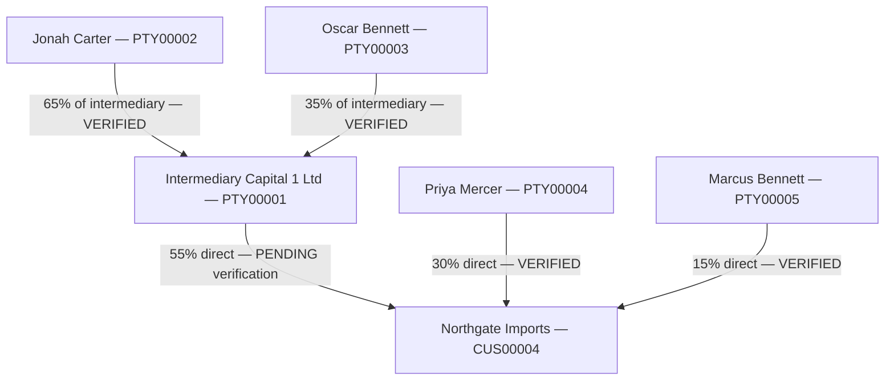

# ClearCase KYC — Featured Investigation 04
## Northgate Imports: layered corporate ownership and UBO verification

> **Scope and provenance:** All names and events are fictional, drawn from the `ClearCase_KYC_Citi_Analyst_Project_Complete_Datasets.zip` synthetic source snapshot and the project's Phase 2 ownership analysis. This is **not** real bank employment, Citi's internal policy, a legally validated UBO register or evidence of wrongdoing. Your live MySQL database may have changed; verify it against `evidence_queries.sql` before publication. **Publication status: evidence-review draft.**

### The investigation question

An event-driven KYC review was opened after an `OWNERSHIP_CHANGE` trigger for a UAE corporate customer. The share register contains one corporate intermediary with a **55% direct stake** and two natural-person owners behind it. The crucial parent-to-customer ownership link is `PENDING` verification. **Who ultimately owns the company, and can this KYC review be completed?**

### Case at a glance — source snapshot

| Field | Recorded finding |
|---|---|
| Customer / ID | **Northgate Imports** / `CUS00004` |
| Type / country / sector | `CORPORATE` / `AE` / Import Export |
| Case / scenario | `KYC001201` / `SC04` |
| Review / trigger | `EVENT_DRIVEN` / `OWNERSHIP_CHANGE` |
| Case status / priority | `PENDING_INFORMATION` / `HIGH` |
| Complexity / assigned analyst | `COMPLEX` / `USR012` |
| Opened / due | 2026-11-03 / 2026-11-13 |
| RM | `USR023` |
| Risk assessment | `RA001201`: score **3.545**, `HIGH`, EDD `YES`, `DRAFT` |
| Screening run | `RUN0001201`: `COMPLETED`, **0 potential hits** on the corporate customer record |
| Information request | `REQ000071`: `UBO_DECLARATION`, `OPEN`, due 2026-11-12 |
| QC / final approval / escalation | No rows for this case in the original snapshot |

### Ownership structure — recorded, not fully verified

| Natural person | Ownership path | Calculation | Effective economic stake | Verification limitation |
|---|---|---|---:|---|
| Jonah Carter | Through intermediary | 55% × 65% ÷ 100 | **35.75%** | Upstream 55% link `PENDING` |
| Priya Mercer | Direct | 30% | **30.00%** | Direct link `VERIFIED` |
| Oscar Bennett | Through intermediary | 55% × 35% ÷ 100 | **19.25%** | Upstream 55% link `PENDING` |
| Marcus Bennett | Direct | 15% | **15.00%** | Direct link `VERIFIED` |
| **Total economic ownership** | | | **100.00%** | **100% reconciles mathematically; not all links are verified** |

**Do not mistake a mathematically complete ownership chart for a fully verified UBO determination.** The intermediate entity's 55% claim requires source-document validation. Equity ownership and control are not always identical; voting rights, nominee arrangements, other control rights and jurisdiction-specific rules must also be evaluated. The synthetic records show voting percentages, but these alone do not prove all forms of control.

### Verification obstacles from this case's own records

| Area | Evidence | Implication |
|---|---|---|
| Main ownership link | `OWN000003` (`PTY00001` → `CUS00004`, 55%) = `PENDING` | Cannot finalize the intermediary ownership pathway from unverified evidence |
| Document collection | One `VERIFIED` incorporation certificate; **four `MISSING`** documents | Further document follow-up required |
| Missing document types | Registered address, director ID, ownership declaration, source-of-funds evidence | Follow-up is broader than the UBO declaration alone |
| Open information request | `REQ000071`, `UBO_DECLARATION`, requested 2026-11-05, due 2026-11-12 | Original request remains open in the snapshot |
| Checklist | `OWNERSHIP_UBO`, `DOCUMENT_VERIFICATION`, `CUSTOMER_RISK_ASSESSMENT`, `QC_APPROVAL` marked `OPEN` | Mandatory controls are unfinished |
| Screening | Corporate-customer run `COMPLETED`, 0 hits | This is not proof that all ultimate owners have been individually screened |
| Risk | Score 3.545, HIGH, EDD YES, `DRAFT` | Recorded model output; not the final approved decision |

### Analyst decision and next steps

**Recommended simulated disposition:** Keep `KYC001201` **PENDING_INFORMATION**; do not certify the UBO position or advance to final QC/approval while mandatory ownership and document gaps remain. Coordinate with RM `USR023` to obtain current signed ownership declarations, trustworthy underlying register/shareholding evidence for `OWN000003`, required missing documents and appropriate identification of the natural-person owners. Check any further controlling persons, voting arrangements or nominee rights and carry out applicable party screening/EDD checks under the simulated policy. Document every finding, source, effective date and outstanding dependency. Route for QC/approval only once the necessary checks are complete.

**Do not automatically mark everyone above or below 25% as the definitive UBO.** A 25% threshold may be useful as an illustrative screening example, but legal and policy thresholds vary by jurisdiction and control rights can matter independently. Do not record a legal conclusion without checking the relevant regime and institution policy.

### One data-quality point worth discussing

The case's trigger is `OWNERSHIP_CHANGE` on 2026-11-03, while the ownership links have earlier `effective_date` values. The source snapshot alone does **not** demonstrate which ownership interest changed on that date. An investigator should request a current ownership declaration and establish a before/after ownership trail rather than claiming a specific change was already verified.

### File contents and usage

- `README.md` — concise case background and ownership chart
- `analyst_note.md` — interview-ready investigation note with evidence / gap / recommendation separation
- `evidence_queries.sql` — read-only MySQL verification queries (run statements one at a time, including the semicolon)
- `interview_prep.md` — 60-second narration, ownership math and interview follow-up questions

**GitHub location:** `featured_cases/04_northgate_imports/` inside your existing ClearCase KYC project. Keep source data synthetic; do not upload `.env` credentials or real identity documents. Report verification as *source snapshot verified* until you've rerun the checks against the current live database.
